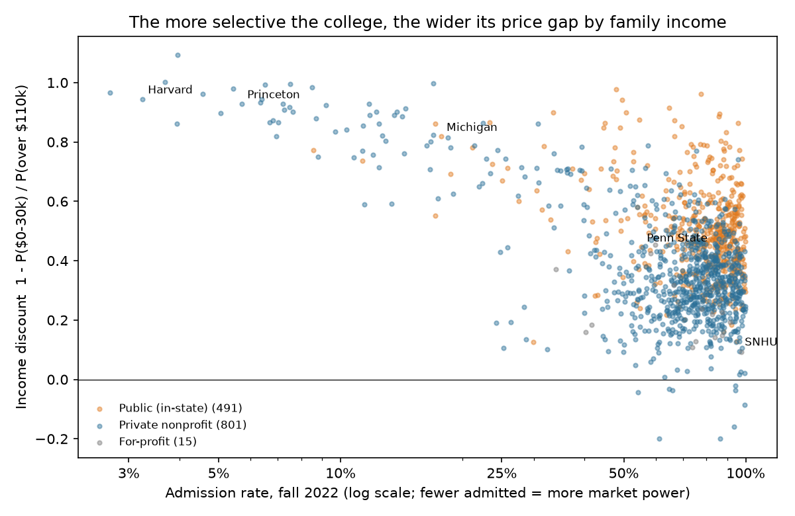
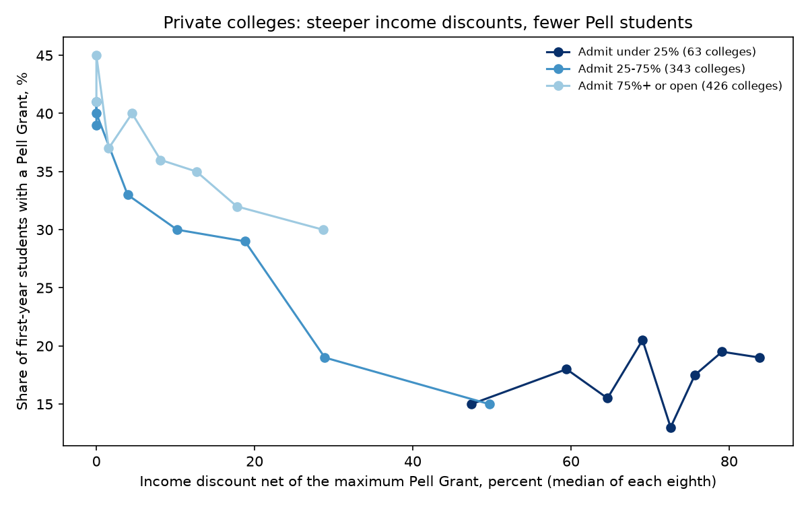

# Who Pays Full Price

### In 1933, Joan Robinson worked out when a seller can charge rich and poor buyers different prices for the same thing. Nine decades later, I tested her theory on what American colleges charge.

---

Harvard's published price for a year of undergraduate study in 2022–23, with tuition, fees, housing, food and other
expenses, was $83,538. Families who received federal aid paid far less, and how much less depended on their income.
Taking the median of the three years from 2020–21 to 2022–23, a Harvard freshman from an aided family earning under
$30,000 paid about $2,895 a year after grants, and one from an aided family earning over $110,000 paid about $52,634.
Southern New Hampshire University charged its poorest aided freshmen $31,967 and its richest $35,345. At Penn State's main campus the same two families paid $20,135 and $36,340.

The Department of Education publishes these figures for nearly every college in the country, in five family-income
groups. They make American higher education an unusually well documented case of what economists call price
discrimination, selling the same product at different prices to different buyers. The classic account of how it
works was written by a young Cambridge economist named Joan Robinson, and it predicts who can charge different prices
and who cannot.

---

## The price rule and the discount

Robinson's starting point was a single formula linking the price a seller charges to how sensitive its buyers are to
price. Economists measure that sensitivity with the elasticity of demand, written *e*. An elasticity of 2 means a 1%
rise in price loses 2% of sales. A seller with some power over its price keeps raising it until the extra revenue
from one more sale just covers the cost of making it. Writing *P* for the price and *MC* for marginal cost, the cost
of one more unit, that happens where

```math
P = MC \cdot \frac{e}{e-1}
```

Robinson's own example, on page 36 of the book, takes an elasticity of 2.

```math
e = 2: \qquad P = MC \cdot \frac{2}{2-1} = 2\,MC
```

As the elasticity grows very large the multiplier approaches 1 and the price falls to cost, which is what
competition does.

Price discrimination follows directly. If a seller can split its buyers into groups that cannot resell to each
other, and the groups differ in their elasticities, it applies the rule separately to each. Marginal cost is the
same for every buyer, so the group with the lower elasticity pays more. In Robinson's words, the markets end up
ranked with "the highest price being charged in the least elastic market" (p. 187).

To measure how far a college *i* goes down this road, I compare the net price it charges its poorest aided families,
those earning under $30,000, with the price it charges its richest, those earning over $110,000. I call the result
the income discount, *D*.

```math
D_i = 1 - \frac{P_{i,\text{low}}}{P_{i,\text{high}}}
```

At Harvard the two prices are $2,895 and $52,634.

```math
D_{\text{Harvard}} = 1 - \frac{2{,}895}{52{,}634} = 0.945
```

The opening's three schools span almost the whole range.

| College | Under $30,000 pays | Over $110,000 pays | Income discount |
|---|---|---|---|
| Harvard University | $2,895 | $52,634 | 94% |
| Penn State, main campus | $20,135 | $36,340 | 45% |
| Southern New Hampshire University | $31,967 | $35,345 | 10% |

A discount of zero means one price for everyone. A discount of 100% means the poorest families pay nothing.

---

## Joan Robinson's question

Joan Robinson was born Joan Maurice in 1903 and read economics at Girton College, Cambridge, finishing in 1925, in
an era when Cambridge did not award degrees to women. She married the economist Austin Robinson in 1926 and
was teaching at Cambridge by 1928. In 1933 Macmillan published *The Economics of Imperfect Competition*. She went on to be one of the leading interpreters of John Maynard Keynes, was promoted to
full professor in 1965, retired from her chair in 1971, and died in Cambridge in 1983.

The book's introduction pictures two men, one handing the other a banana and taking a penny for it, and asks why the
price is a penny rather than any other sum. Robinson's answer treated every seller as having some control over
its price and built the analysis on marginal revenue, the extra money a seller takes in from one more sale. Edward Chamberlin's *Theory of Monopolistic
Competition* appeared the same year, and together the two books changed how price theory was taught. In her foreword
Robinson wrote that the problems of price discrimination were solved as much by her colleague Richard Kahn as by
herself.

Chapters 15 and 16 hold the theory tested here. Robinson's examples are railways that charge different rates to
carry cotton and coal, exporters who sell abroad more cheaply than at home, and doctors. Surgeons, she wrote, "grade
the fee for an operation according to the wealth of the patient" (p. 180). Under perfect competition every buyer can walk away to a rival, the
elasticity in every market is effectively infinite, and one price prevails. When sellers face little competition, or
"when there is an agreement between rival sellers," she wrote, discrimination becomes likely (p. 180). She also
worked out what discrimination does to total sales. With straight-line demand curves it leaves output exactly where
a single price would, a result Arthur Pigou had found first. It raises output when it lets the seller reach buyers a
single price would shut out, and her example was the country doctor who would not set up in practice if he could not
charge his rich patients more (p. 203).

The core of chapter 15 fits in four lines. Take a seller with two markets, numbered 1 and 2, selling quantities
$`q_1`$ and $`q_2`$ at prices set by each market's demand curve, with one cost function *C* for the combined output,
so marginal cost is common to both markets. It chooses the two quantities to maximize profit, π.

```math
\begin{aligned}
\max_{q_1,\,q_2}\ \pi &= P_1(q_1)\,q_1 + P_2(q_2)\,q_2 - C(q_1+q_2) \\
\frac{\partial \pi}{\partial q_j} &= P_j + P_j'(q_j)\,q_j - C'(q_1+q_2) = 0, \qquad j = 1,2 \\
MR_j &= P_j\left(1 - \frac{1}{e_j}\right) = MC, \qquad e_j \equiv -\frac{dq_j}{dP_j}\,\frac{P_j}{q_j} \\
\frac{P_1}{P_2} &= \frac{1 - 1/e_2}{1 - 1/e_1}
\end{aligned}
```

The ratio of the two prices depends only on the two elasticities, and the less elastic market pays more. If the
elasticities are equal there is nothing to gain, which is Robinson's village barber who finds no profit in charging
red-haired customers differently (p. 185).

The same lines put a floor under the markup a pair of prices implies. Marginal cost equals marginal revenue in the
low-price market, and marginal revenue is always below price, so marginal cost is below the lowest price. The markup
on the richest buyers as a share of their price, the Lerner index *L*, must then exceed the income discount.

```math
\begin{aligned}
MC &= P_{\text{low}}\left(1 - \frac{1}{e_{\text{low}}}\right) < P_{\text{low}} \\
L_{\text{high}} &\equiv \frac{P_{\text{high}} - MC}{P_{\text{high}}} > 1 - \frac{P_{\text{low}}}{P_{\text{high}}} = D
\end{aligned}
```

For a profit-seeking Harvard, a discount of 0.945 would mean a markup of more than 94% on its richest families. That
points to the strongest objection to taking her theory to colleges, which is that colleges are not her monopolist.
Robinson assumed a seller maximizing profit. A nonprofit university that charges poor families little may be
pursuing a mission, or following federal aid rules, rather than exploiting differences in elasticity. Both accounts
predict that the poor pay less, so the level of discounting cannot tell them apart. They differ in what they
require. Charity requires money, while Robinson's discrimination requires market power, and she was emphatic that
competition rules it out.

---

## How I tested it

All the data come from the Department of Education's Integrated Postsecondary Education Data System (IPEDS). For
every four-year college, it reports the average net price, meaning the full cost of attendance minus all grants,
paid by first-time, full-time freshmen who received federal aid, in five family-income groups. I took the median of
the three years in the 2022–23 file (2020–21 through 2022–23), which protects against a single bad entry such as
Yale's $28,132 for its poorest families in 2022–23, against $341 the year before. I kept colleges with all five
prices and at least ten aided freshmen in both the lowest and highest income groups, which left 1,457 schools, 832
private nonprofit, 593 public and 32 for-profit. Public prices are for in-state students.

I measured market power by the admission rate for fall 2022. A school that turns away 95% of its applicants can
raise its price to any one group and still fill its class, which is what a low elasticity means. Because federal
Pell Grants, worth up to $6,895 in 2022–23, lower the price for poor families at every college, I also report a
version of the discount that adds the maximum Pell Grant back to the poorest families' price, which leaves roughly
the part of the discount each college and state chose.

The main test is a regression across colleges. For college *i*, *D* is the income discount, *A* the admission rate,
*E* endowment per full-time-equivalent student, *S* the published sticker price for a year on campus, and δ a
separate intercept for each state *s*, so that each college is compared only with others in its own state.

```math
\begin{aligned}
D_i &= \alpha + \beta \ln A_i + \gamma_1 \ln(1 + E_i) + \gamma_2 \ln S_i + \delta_{s(i)} + \varepsilon_i \\
H_0&: \beta = 0 \qquad H_1 \text{ (Robinson)}: \beta < 0
\end{aligned}
```

I run it separately
for private nonprofit and public colleges, with heteroskedasticity-robust (HC1) standard errors, and trim each
discount measure at its own 1st and 99th percentiles. For the output question I swap the outcome,
*Y*, for each college's Pell share, its number of Pell recipients or its first-year class size, and put the discount
on the right-hand side with coefficient θ.

```math
\begin{aligned}
Y_i &= \alpha + \theta D_i + \beta \ln A_i + \gamma_1 \ln(1 + E_i) + \gamma_2 \ln S_i + \delta_{s(i)} + u_i \\
H_0&: \theta = 0 \qquad \text{output in the weaker market rises if } \theta > 0
\end{aligned}
```

---

## The most selective colleges charge the widest price gaps

Among private colleges the gap between what the poorest and richest families pay widens steeply as admission rates
tighten below one half. Above that line the gradient flattens, and colleges admitting 50–75% discount slightly less
than those admitting more.

| Private nonprofit colleges, by admission rate | Colleges | Under $30,000 pays | Over $110,000 pays | Income discount | Discount beyond Pell |
|---|---|---|---|---|---|
| Under 10% | 26 | $3,344 | $47,066 | 93% | 77% |
| 10–25% | 37 | $10,988 | $48,971 | 79% | 64% |
| 25–50% | 66 | $17,516 | $39,631 | 43% | 24% |
| 50–75% | 277 | $18,857 | $28,028 | 30% | 5% |
| 75% or more | 395 | $18,598 | $28,070 | 33% | 7% |
| Open admission | 31 | $16,337 | $22,727 | 26% | 0% |

*Medians across colleges. Prices are annual net prices for aided first-time freshmen.*

At the most selective colleges the richest families pay about 14 times what the poorest pay. At colleges that admit
most applicants, the poorest pay about two-thirds of the top price, and the federal Pell Grant accounts for almost
all of the difference.



The most selective schools also have the largest endowments, but wealth explains only part of this. With endowment
per student, sticker price and state held constant, the estimates of β are

```math
\begin{aligned}
\hat{\beta}_{\text{private}} &= -0.166\ (0.009), \quad 95\%\ \text{CI}\ [-0.184,\ -0.147], \quad N = 793 \\
\hat{\beta}_{\text{public}} &= -0.083\ (0.021), \quad 95\%\ \text{CI}\ [-0.125,\ -0.041], \quad N = 481
\end{aligned}
```

A private college that admits half as large a share of applicants as another, in the same state and with the same
endowment and sticker price, has an income discount 11.5 points larger. Among public universities the same
comparison gives 5.8 points. The relationship survives adding the yield, the share of admitted students who enroll,
and it is at least as large when the Pell Grant is taken out.

---

## Colleges with no market power barely discriminate

The cleanest version of Robinson's prediction concerns sellers facing the most competition. Among colleges that
admit three-quarters or more of applicants, or anyone who applies, the for-profits are the closest thing in the data
to her profit-maximizing seller.

| Open or near-open admission | Colleges | Income discount | Discount beyond Pell | Over $110,000 pays |
|---|---|---|---|---|
| Public (in-state) | 435 | 47% | 10% | $19,478 |
| Private nonprofit | 426 | 32% | 6% | $27,908 |
| For-profit | 25 | 16% | 0% | $29,646 |

The median for-profit college gives its poorest aided families no discount of its own beyond the federal grant.
The comparison is thin, since only 25 for-profits pass the sample rules and the adjusted measure is zero for any
college whose gap is under $6,895. Within it, firms that exist to maximize profit choose not to charge much more by
income, which fits Robinson's claim that competition forces a single price. Public universities discount more at the same admission rates, and their
low-income prices include state grants that the colleges do not set. Familiar names follow the same gradient.

| College | Admits | Under $30,000 pays | $48,000–75,000 pays | Over $110,000 pays | Income discount |
|---|---|---|---|---|---|
| MIT | 4% | −$4,129 | $1,918 | $44,726 | 109% |
| Stanford | 4% | −$79 | $3,637 | $49,457 | 100% |
| Harvard | 3% | $2,895 | $2,167 | $52,634 | 94% |
| Princeton | 6% | $2,841 | $6,975 | $39,943 | 93% |
| University of Michigan | 18% | $4,926 | $11,621 | $27,199 | 82% |
| UCLA | 9% | $6,864 | $11,065 | $30,301 | 77% |
| NYU | 12% | $16,816 | $18,555 | $58,906 | 71% |
| Penn State | 55% | $20,135 | $27,137 | $36,340 | 45% |
| Grand Canyon University | 78% | $18,207 | $21,977 | $23,879 | 24% |
| Southern New Hampshire University | 96% | $31,967 | $33,040 | $35,345 | 10% |
| Liberty University | 99% | $30,398 | $27,214 | $31,028 | 2% |
| Full Sail University | open | $29,893 | $28,856 | $30,479 | 2% |

MIT's poorest aided students receive more in grants than the full cost of attendance, and Stanford's come out almost
exactly even. Grand Canyon is listed by the Department of Education as a for-profit college for these years. At
Liberty and Full Sail the poorest and richest families pay within about $600 of each other.

---

## The universities sued over shared aid formulas discount more than their peers

Robinson's remark that discrimination is easier when rival sellers agree has a modern test case. In January 2022,
plaintiffs sued a group of elite private universities, later 17 in all, in federal court in Chicago, alleging that
through the "568 Presidents Group" they had used a shared method of judging what families could pay and so held down
financial aid. By July 2024 a judge had approved settlements totaling $284 million from 10 of them, and further
settlements followed. The settlements are not findings of wrongdoing.

| Private colleges admitting under 15% | Colleges | Median admission rate | Under $30,000 pays | Over $110,000 pays | Median income discount |
|---|---|---|---|---|---|
| Defendants in the 568 case | 17 | 6.5% | $3,393 | $47,835 | 93% |
| Other private colleges | 28 | 11.0% | $5,798 | $49,131 | 87% |

In 2020–21 through 2022–23 the defendants discounted somewhat more steeply than other highly selective private
colleges, not less. In a regression of the discount on a defendant indicator with log admission rate and log
endowment held constant, the coefficient on that indicator, λ, is

```math
\hat{\lambda}_{568} = 0.046\ (0.021), \quad p = 0.029, \quad N = 45
```

or 4.6 points. This does not answer the lawsuit's question, which is how generous aid would have been without
coordination, and the years observed run from 2020–21, before the suit, through 2022–23, while it was pending. What the data
rule out is that the defendants stood apart from their peers in those years as unusually stingy toward poor
families.

---

## Steeper discounts have not brought in more low-income students

Robinson's output result decides whether discrimination is good or bad for society. If charging the rich more lets a
seller serve buyers it would otherwise lose, output rises and the poor gain. For a college the weaker market is
low-income students, measured here by the share of freshmen receiving a Pell Grant, the federal grant for students
from low-income families.

Among private colleges admitting a quarter or more of their applicants, those that discount most steeply enroll a
smaller share of Pell students. In the two most selective tiers the Pell share barely moves, staying between 15.5%
and 19% whatever the discount.

| Private nonprofit, by admission rate | Lowest third of discounts | Middle third | Highest third |
|---|---|---|---|
| 25–50% | 35% Pell | 20% Pell | 13% Pell |
| 50–75% | 40% Pell | 34% Pell | 24% Pell |
| 75% or more | 40% Pell | 37% Pell | 32% Pell |

*Median share of full-time first-time freshmen receiving a Pell Grant. Discount thirds use the discount beyond Pell.*



With selectivity, endowment, sticker price and state held constant, the estimates of θ for private colleges, using
the discount beyond Pell, are

```math
\begin{aligned}
\text{Pell share:}\quad \hat{\theta} &= -17.7\ (4.4), \quad 95\%\ \text{CI}\ [-26.4,\ -9.0], \quad N = 793 \\
\ln(\text{Pell recipients}):\quad \hat{\theta} &= -0.23\ (0.26), \quad 95\%\ \text{CI}\ [-0.74,\ 0.29], \quad N = 793
\end{aligned}
```

A 10-point steeper discount goes with a Pell share 1.8 points lower among private colleges, and 2.7 points lower
among public ones. With the unadjusted discount the private estimate shrinks to about one point (p = 0.015) and the
public one is indistinguishable from zero, so the sign is stable but the size is not. The steeper discounters also
have first-year classes about 6% larger per 10 points of discount (p = 0.03, Pell-adjusted measure only), yet the
number of Pell recipients in those classes does not rise; the estimate is −2% per 10 points and the confidence
interval spans zero. Where the steep discounters do have larger classes, the extra seats appear to go to students
without Pell Grants.

Robinson noted that the more elastic market "may often be composed of a large number of poor
buyers" (p. 202), and that when their demand curve has the wrong shape, discrimination can shrink output rather than
expand it. A cross-section cannot recover demand curves or show what any college would do under a single price, but
the colleges with the steepest income discounts are plainly not the ones enrolling the most low-income students.

---

## Why it matters

For families, the published price of a selective private college is a price for the richest buyers only, and
Robinson's logic explains why it can be set so high. The poorest families at
those same schools pay less than at almost any other kind of college.

For low-income students, the generosity is concentrated where the seats are scarcest. The 26 private colleges
admitting under 10% charge their poorest families a median of $3,344, but their freshman classes are about one-fifth
Pell recipients, while the less selective private colleges that enroll nearly twice that share charge the same
families around $18,600.

For less selective colleges, the data show what competing without market power looks like. Southern New Hampshire,
Liberty and the for-profits charge nearly one price, and their low-income students pay close to what the richest
pay. That is what Robinson's theory expects of sellers whose richest buyers have many other places to go.

For policy, the 568 case is Robinson's agreement between rival sellers in modern form. Whether shared aid formulas
helped or hurt poor families depends on what they would have paid under competition, which a cross-section of
current prices cannot settle.

---

## Limits of this study

The net prices cover only freshmen who received federal aid, so the "over $110,000" price at a rich college is paid
by the minority of high-income families who took federal loans or grants, not by those paying in full. The income
groups are wide and stop at $110,000, so the theory's sharpest contrasts, between a family at $120,000 and one at
$600,000, are invisible. The prices include federal and state grants that colleges do not set, and my Pell
adjustment uses the maximum award rather than each student's actual award. Admission rates measure market power
loosely; a school can look selective because it attracts many applications it never intends to accept. Colleges are
not profit-maximizing firms, so these results show that discounting follows the pattern Robinson predicted for
market power, not that colleges behave as her monopolist. Every comparison is across colleges at one point in time,
and none of it identifies what any college would charge under a single price.

---

## Further reading

- [TECHNICAL.md](TECHNICAL.md) has the data files, sample rules, test statistics and reproduction steps.
- [results/FINDINGS.md](results/FINDINGS.md) has a plain-English summary and every table.
- [METHODS_REVIEW.md](METHODS_REVIEW.md) reviews the methods of the original book.
- The original work is Joan Robinson, *The Economics of Imperfect Competition*, Macmillan, London, 1933. Book V,
  chapters 15 and 16 (pp. 179–208), covers price discrimination. I read the 1933 edition in the scan held by the
  Internet Archive (Digital Library of India collection).
- College data come from the US Department of Education, National Center for Education Statistics, IPEDS complete
  data files (https://nces.ed.gov/ipeds/datacenter/DataFiles.aspx): Student Financial Aid and Net Price 2022–23,
  Admissions 2022, Institutional Characteristics 2022, Directory 2022 and the derived finance file for fiscal 2023.
- The 2022–23 maximum Pell Grant is from Federal Student Aid, Dear Colleague Letter GEN-22-04 (March 24, 2022).
- The 568 case is *Henry v. Brown University*, No. 1:22-cv-00125 (N.D. Ill.); settlement amounts are as reported by
  WHYY, July 23, 2024.

*Brendyn Beasley*
